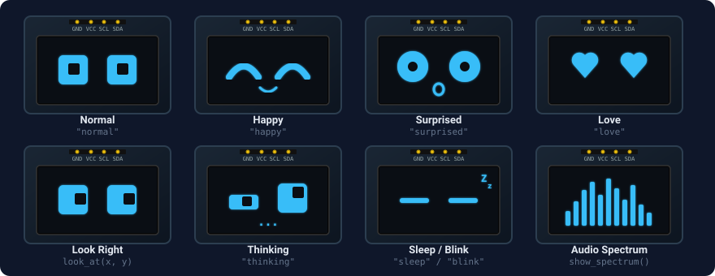

Recipes
=======

This section covers practical examples for controlling various sensors and components using ``espzero``. All examples assume ``import espzero; espzero.begin()`` has been called.

Built-in LED
------------

The simplest way to control the on-board LED.

.. code-block:: python

    from espzero import esp_led
    from time import sleep

    esp_led.on()    # Turn on
    sleep(1)
    esp_led.off()   # Turn off
    esp_led.blink() # Blink in the background

Digital Output (LED)
--------------------

Control a regular LED connected to a specific pin.

.. image:: /images/circuit_led.svg
    :alt: ESP32 LED Circuit Wiring Diagram
    :align: center

.. code-block:: python

    from espzero import LED

    led = LED(4) # GPIO 4

    led.on()
    led.off()
    led.toggle()
    
    # Blink 5 times with 0.5s intervals (asynchronous)
    led.blink(on_time=0.5, off_time=0.5, n=5)

PWM Control (Brightness)
~~~~~~~~~~~~~~~~~~~~~~~~

.. code-block:: python

    led.value = 0.5 # 50% brightness
    led.pulse()     # Fade in and out repeatedly

RGB LED
-------

External 4-pin RGB LED
~~~~~~~~~~~~~~~~~~~~~~

Combine Red, Green, and Blue pins to create various colors.
(Note: ESP32-S3 boards lack pins 22–34, so use universally supported pins such as GPIO 4, 5, 6.)

.. image:: /images/circuit_rgb.svg
    :alt: ESP32 RGB LED Circuit Wiring Diagram
    :align: center

.. code-block:: python

    from espzero import RGBLED
    from time import sleep

    # Universally supported pins for ESP32 and ESP32-S3 (e.g. GPIO 4, 5, 6)
    rgb = RGBLED(red=4, green=5, blue=6)

    rgb.color = (255, 0, 0)   # Red
    sleep(0.5)
    rgb.color = (0, 255, 0)   # Green
    sleep(0.5)
    rgb.color = (255, 255, 0) # Yellow (Red + Green)
    sleep(0.5)

    # Adjust individual channel brightness (0~255)
    rgb.red = 128
    rgb.blue = 255

    # Color inversion and toggle
    rgb.invert()
    rgb.toggle()

    # Dynamic animations (blink, pulse fade, rainbow cycle)
    rgb.blink(on_times=0.5, colors=((255, 0, 0), (0, 255, 0), (0, 0, 255)), n=2, wait=True)
    rgb.pulse(fade_times=1, n=2, wait=True)  # Smooth fade pulse
    rgb.cycle(fade_times=1, n=2, wait=True)  # Rainbow color cycle

    rgb.off()

Built-in Onboard RGB LED (ESP32-S3 WS2812 NeoPixel)
~~~~~~~~~~~~~~~~~~~~~~~~~~~~~~~~~~~~~~~~~~~~~~~~~~~

For boards with a built-in WS2812 NeoPixel RGB LED (such as ESP32-S3 DevKit or M5Stack), simply use ``esp_led`` without specifying pin numbers:

.. code-block:: python

    from espzero import esp_led
    from time import sleep

    esp_led.color = (255, 0, 0)   # Red
    sleep(0.5)
    esp_led.color = (0, 255, 0)   # Green
    sleep(0.5)
    esp_led.color = (0, 0, 255)   # Blue
    sleep(0.5)

    # On-board NeoPixel rainbow cycle animation
    esp_led.cycle(fade_times=0.5, n=3, wait=True)
    esp_led.off()

Buzzer & Speaker
----------------

Simple Beep
~~~~~~~~~~~

.. image:: /images/circuit_buzzer.svg
    :alt: ESP32-S3 Buzzer Circuit Wiring Diagram
    :align: center

.. code-block:: python

    from espzero import Buzzer

    bz = Buzzer(15)
    bz.beep(on_time=0.1, off_time=0.1, n=3) # "Beep-Beep-Beep"

Playing Melodies
~~~~~~~~~~~~~~~~

.. code-block:: python

    from espzero import Speaker

    spk = Speaker(15)

    # List of (note, duration) tuples
    tune = [
        ('c4', 0.5), ('d4', 0.5), ('e4', 0.5), ('c4', 0.5),
        ('e4', 0.5), ('c4', 0.5), ('g4', 1.0)
    ]
    spk.play(tune)

Input Devices
-------------

Button
~~~~~~

.. image:: /images/circuit_button.svg
    :alt: ESP32 Button Circuit Wiring Diagram
    :align: center

.. code-block:: python

    from espzero import Button

    btn = Button(5)

    btn.when_pressed = lambda: print("Pressed!")
    btn.when_released = lambda: print("Released!")

Potentiometer
~~~~~~~~~~~~~

.. image:: /images/circuit_potentiometer.svg
    :alt: ESP32 Potentiometer Circuit Wiring Diagram
    :align: center

.. code-block:: python

    from espzero import Pot

    pot = Pot(1) # Analog pin (ADC1_CH0, ESP32-S3)

    print("Current value (0-1):", pot.value)
    print("Voltage (V):", pot.voltage)

Servo Motor (Servo)
~~~~~~~~~~~~~~~~~~~

Control standard servo motors via ratio (0.0 to 1.0) or angles (0 to 180 degrees) with ``picozero-rw`` compatibility.

.. image:: /images/circuit_servo.svg
    :alt: ESP32 Servo Motor Circuit Wiring Diagram
    :align: center

.. code-block:: python

    from espzero import Servo
    from time import sleep

    servo = Servo(13)

    # Position control (0.0: min, 0.5: mid, 1.0: max)
    servo.mid()
    sleep(1)

    # Move to specific angle (move_to_degree API)
    servo.move_to_degree(90)   # 90 degrees (mid)
    sleep(1)
    servo.move_to_degree(180)  # 180 degrees (max)
    sleep(1)
    servo.move_to_degree(0)    # 0 degrees (min)

    # Smooth sweeping back and forth (0 deg <-> 180 deg)
    servo.pulse(fade_in_time=1, fade_out_time=1)

Motors & Robots (Motor & Robot)
-------------------------------

DC Motor (Motor)
~~~~~~~~~~~~~~~~

Control bidirectional DC motors via motor driver boards (e.g. L298N, L9110S, DRV8833).

.. image:: /images/circuit_motor.svg
    :alt: ESP32 DC Motor Driver Circuit Wiring Diagram
    :align: center

.. code-block:: python

    from espzero import Motor
    from time import sleep

    # Specify forward and backward GPIO pins (supports PWM speed control)
    motor = Motor(forward=4, backward=5)

    # Rotate forward at full speed
    motor.forward()
    sleep(1)

    # Rotate backward at 50% speed
    motor.backward(0.5)
    sleep(1)

    # Timed rotation (runs for 1s then stops automatically)
    motor.forward(speed=0.8, t=1, wait=True)

    # Stop motor
    motor.stop()

Robot Rover (Two-Wheel Drive Platform)
~~~~~~~~~~~~~~~~~~~~~~~~~~~~~~~~~~~~~~

Easily steer a 2-wheeled robot rover with forward, backward, left, and right movements.

.. image:: /images/circuit_robot.svg
    :alt: ESP32 2-Wheel Robot Rover Circuit Wiring Diagram
    :align: center

.. code-block:: python

    from espzero import Robot
    from time import sleep

    # left=(fwd_pin, bwd_pin), right=(fwd_pin, bwd_pin) using camera-safe GPIOs
    robot = Robot(left=(41, 42), right=(47, 21))

    # Basic movements
    robot.forward()
    sleep(1)
    robot.backward(0.6)
    sleep(1)

    # Turning left and right
    robot.left(speed=0.8)
    sleep(0.5)
    robot.right(speed=0.8)
    sleep(0.5)

    # Timed movements (drive in a square pattern)
    for _ in range(4):
        robot.forward(t=1, wait=True)
        robot.left(t=0.5, wait=True)

    # Stop rover
    robot.stop()

Built-in Touch Sensor (Capacitive Touch)
~~~~~~~~~~~~~~~~~~~~~~~~~~~~~~~~~~~~~~~~

Use the built-in capacitive touch peripheral on ESP32 / ESP32-S3. Detects touch directly from a finger or conductive wire without external resistors.

.. code-block:: python

    from espzero import CapTouch
    from time import sleep

    # WROOM: T0~T9 (e.g. GPIO 4), ESP32-S3: touch-capable pin (e.g. GPIO 1)
    touch = CapTouch(1)

    while True:
        # value: raw capacitance reading (decreases when touched)
        # is_touched: True if raw value drops below threshold (default: 300)
        print("Raw:", touch.value, "Touched:", touch.is_touched)
        sleep(0.2)

Distance Sensor
---------------

Measure distance safely on ESP32-S3 using a 3.3V-compatible ultrasonic sensor such as ``HC-SR04P``.

.. image:: /images/circuit_distance.svg
    :alt: ESP32-S3 HC-SR04P Ultrasonic Distance Sensor Circuit Wiring Diagram
    :align: center

.. warning::
    **Overvoltage Risk with Legacy 5V-Only HC-SR04 Sensors**:
    ESP32-S3 GPIOs have a maximum input tolerance of **3.6V**. Newer **HC-SR04P** / **HC-SR04+** sensors run directly from the board's **3V3** pin with safe 3.3V logic.
    If you use a legacy 5V-only **HC-SR04**, its ``ECHO`` pin outputs **5V**, which can damage ``G14``. You must insert a **1kΩ + 2kΩ resistor voltage divider** (``ECHO → 1kΩ → G14``, ``G14 → 2kΩ → GND``) to step the ``ECHO`` signal down to ~3.3V.

.. code-block:: python

    from espzero import DistanceSensor

    # echo=14, trigger=13
    ds = DistanceSensor(echo=14, trigger=13)

    while True:
        print("Distance: ", ds.distance, "cm")
        sleep(0.5)

Temperature Sensor
------------------

Internal Temperature
~~~~~~~~~~~~~~~~~~~~

Measure the internal temperature of the ESP32 chip. (Note: May differ from ambient temperature).

.. code-block:: python

    from espzero import esp_temp_sensor

    print("Internal chip temp:", esp_temp_sensor.temp, "C")

Complex Example: Button-controlled Light
---------------------------------------

Toggle an LED each time a button is pressed.

.. code-block:: python

    from espzero import LED, Button, begin

    begin()
    led = LED(4)
    btn = Button(5)

    btn.when_pressed = led.toggle

    while True:
        pass # Wait for events

Stepper Motor
-------------

Control a stepper motor connected via a driver board (e.g. ULN2003).

Analog clock
~~~~~~~~~~~~

Create a continuously-running analog clock second hand:

.. literalinclude:: examples/stepper_analog_clock.py

Automatic blinds
~~~~~~~~~~~~~~~~

Time-based blind controller:

.. literalinclude:: examples/stepper_automatic_blinds.py

Displays (OLED & LCD)
---------------------

I2C OLED Display (SSD1306 / SH1106, 3.3V Recommended)
~~~~~~~~~~~~~~~~~~~~~~~~~~~~~~~~~~~~~~~~~~~~~~~~~~~~~

0.96" (``SSD1306``) and 1.3" (``SH1106``) I2C OLED displays operate natively on 3.3V logic and can connect directly to the ESP32-S3 without a level shifter.

.. image:: /images/circuit_oled.svg
    :alt: ESP32-S3 I2C OLED Display Circuit Wiring Diagram
    :align: center

.. code-block:: python

    from espzero import OLED

    # 0.96" SSD1306 (pass driver="sh1106" for 1.3" SH1106 panels)
    oled = OLED(scl=47, sda=21)

    oled.clear()
    oled.text("Hello, ESPZero!", 0, 0)
    oled.text("ESP32-S3 OLED", 0, 20)
    oled.rect(0, 36, 128, 20, color=1)
    oled.show()

Robot Face Expressions & Gaze Tracking
^^^^^^^^^^^^^^^^^^^^^^^^^^^^^^^^^^^^^^

``oled.show_face()`` provides 10 expressive robot emotion presets (``"normal"``, ``"happy"``, ``"surprised"``, ``"love"``, ``"thinking"``, ``"sleep"``, ``"blink"``, ``"angry"``, ``"sad"``, ``"listening"``) with customizable gaze direction (``look_x``, ``look_y``).
With ``oled.look_at(x, y)``, you can directly pass camera hand-tracking coordinates or joystick readings to have the robot eyes track user movements in real time.

.. code-block:: python

    from espzero import OLED
    from time import sleep

    oled = OLED(scl=47, sda=21)

    # 1. Emotion presets
    oled.show_face("happy")      # Cheerful smile (^ ^)
    sleep(1)
    oled.show_face("surprised")  # Wide-eyed surprised (O O)
    sleep(1)
    oled.show_face("love")       # Heart-shaped eyes
    sleep(1)

    # 2. Gaze direction: Left (-1.0) / Right (1.0) / Up / Down
    oled.show_face("normal", look_x=-1.0, look_y=0.0)  # Look left
    sleep(1)
    oled.show_face("normal", look_x=1.0, look_y=0.0)   # Look right
    sleep(1)

    # 3. Seamless eye gaze tracking with vision.get_hand() (desktop companion robot)
    # oled.look_at(hand_x, hand_y, emotion="happy")

LCD Display (16x2, PCF8574)
~~~~~~~~~~~~~~~~~~~~~~~~~~~

Print characters on LiquidCrystal displays (LCD) using the I2C bus and a PCF8574 I2C adapter.

.. warning::
    **Level Shifter Required for 5V PCF8574 I2C Adapters**:
    Most ``16x2 I2C LCD (PCF8574)`` modules operate at 5V and pull ``SDA`` / ``SCL`` up to **5V**.
    To protect ESP32-S3's 3.3V pins (``G21``, ``G47``), always place a **3.3V↔5V bidirectional I2C logic level shifter** between the board and the PCF8574 module (or use the native **3.3V OLED display** shown above).

.. image:: /images/circuit_i2c_lcd.svg
    :alt: ESP32-S3 I2C LCD with Logic Level Shifter Circuit Wiring Diagram
    :align: center

.. literalinclude:: examples/i2c_lcd.py

Print characters on LiquidCrystal displays (LCD) by using GPIO pins only.

.. literalinclude:: examples/lcd.py

AI Vision
---------

Examples for using the ESP32-S3 camera with PC-assisted AI and standalone on-device AI.

.. important::
    **Camera-Enabled Firmware Required**:
    The official generic MicroPython firmware does not include the camera C driver (``camera`` module).
    To use vision features, ensure your board (e.g. ESP32-S3 WROOM CAM) is flashed with a **Camera-enabled MicroPython firmware**.

.. note::
    **Firmware Flashing Options (Mu Editor / External Tools)**:

    * **Option A (Mu Editor Built-in Flasher)**: Click **Settings (gear icon)** at bottom-right → **[ESP Firmware flasher]** tab (or **[ESP Online Flasher]** tab), select your board (ESP32-S3), choose your camera-enabled firmware (``.bin``), and click **[Erase & write firmware]**.
    * **Option B (Terminal / ``esptool``)**: If using VS Code, Thonny, or another editor, install ``pip install esptool`` and flash via CLI:

      .. code-block:: bash

          esptool --chip esp32s3 --port COMx erase_flash
          esptool --chip esp32s3 --port COMx --baud 460800 write_flash -z 0x0 firmware.bin

PC-Side AI (with MediaPipe — Mu Editor Only)
~~~~~~~~~~~~~~~~~~~~~~~~~~~~~~~~~~~~~~~~~~~~

.. note::
    **Mu Editor Serial Protocol Only**: ``vision.start_stream_to_pc()`` streams JPEG frames over USB serial directly to Mu Editor's built-in Camera/MediaPipe viewer. If you are using VS Code, Thonny, or another IDE, use the **Wi-Fi Video Streaming (``vision.start_wifi_stream()``)** workflow below instead.

Streams camera images to the PC (Mu Editor), which uses Google's MediaPipe library to track hands, faces, etc., in real time. The detected coordinates are sent back to the ESP32 for hardware control.

.. code-block:: python

    from espzero import vision
    from time import sleep

    # Start streaming camera frames to the PC (non-blocking background thread)
    vision.start_stream_to_pc()

    while True:
        # Read the hand coordinates injected by the editor
        if "__pc_ai_data" in globals():
            x = __pc_ai_data.get("hand_x", 0)
            y = __pc_ai_data.get("hand_y", 0)
            detected = __pc_ai_data.get("hand_detected", False)
            if detected:
                print("Hand detected -> X:", x, "Y:", y)
        sleep(0.1)

Wi-Fi Video Streaming & PC YOLO Autonomous Driving
~~~~~~~~~~~~~~~~~~~~~~~~~~~~~~~~~~~~~~~~~~~~~~~~~~

As a microcontroller, the ESP32-S3 has limited hardware RAM and computing power, making it challenging to run heavy modern deep learning models (such as YOLOv8) directly on-device.
However, by dividing responsibilities between the ESP32 and a PC over **Wi-Fi**, you can build a high-performance autonomous driving robot car with ease.

**Working Principle & Role Division**:

.. code-block:: text

    [ ESP32 Robot Car ] (Eyes & Feet)
      - Streams camera video wirelessly over Wi-Fi (MJPEG stream)
      - Drives DC motors according to received wireless commands ('GO' / 'STOP')
      ▲
      │  (Wi-Fi Network: Real-time Video Stream & Driving Commands)
      ▼
    [ PC / Mu Editor - Python 3 Mode ] (Brain)
      - Receives Wi-Fi video stream and runs YOLOv8 in real time on PC CPU/GPU
      - Detects obstacles/pedestrians and sends 'STOP' or 'GO' commands wirelessly

**Step-by-Step Practical Guide (Mu Editor / Standard Python IDEs)**:

1. **PC YOLO Environment Setup**:
   Prepare the required packages to run YOLO inference on your PC.

   * **Option A (In Mu Editor)**:
     Mu Editor already has ``opencv-python`` and ``requests`` built-in. Simply click the **Settings (gear icon)** at bottom-right → **[Third-party Packages]** tab, enter ``ultralytics``, and click [OK].

   * **Option B (External Editors like VS Code)**:
     If running outside Mu, install all necessary packages via CMD or PowerShell:

     .. code-block:: bash

         pip install ultralytics opencv-python requests

2. **Step 1: Upload ESP32 Robot Car Code (Mu [ESP32 Mode] or Thonny / mpremote)**:
   Save the code below as ``main.py`` on the ESP32 board (use **ESP32 mode** in Mu, or ``mpremote cp main.py :main.py`` from CLI).
   (Saving as ``main.py`` allows you to unplug the USB cable and power the car with batteries; it will automatically connect to Wi-Fi and start streaming on boot. Check the ESP32 IP address printed in the REPL, e.g., ``192.168.0.50``.)

   .. code-block:: python

       from espzero import WiFi, vision, Robot
       from time import sleep

       # 1. Connect to Wi-Fi access point
       wifi = WiFi()
       wifi.connect("My_WiFi_SSID", "password")

       # 2. Configure 2-wheel robot motors using camera-safe pins (Left: GPIO 41, 42 / Right: GPIO 47, 21)
       car = Robot(left=(41, 42), right=(47, 21))

       # 3. Start wireless camera stream (default port: 8080)
       vision.start_wifi_stream(port=8080)

       # 4. Driving loop reading AI decisions from PC
       while True:
           if "__pc_ai_data" in globals():
               action = __pc_ai_data.get("action", "STOP")
               if action == "GO":
                   car.forward(0.6) # Move forward when clear
               else:
                   car.stop()       # Stop if pedestrian or obstacle detected
           sleep(0.05)

3. **Step 2: Run PC AI Autonomous Driving Controller (Mu [Python 3 Mode] or Standard Python)**:
   Run the script below in Mu Editor's **Python 3 mode**, or save it as ``yolo_drive.py`` and run ``python yolo_drive.py`` in VS Code / terminal after updating ``STREAM_URL`` and ``CMD_URL`` with your ESP32 IP address.
   A live video window showing real-time detection boxes will appear on your PC, autonomously piloting the robot car!

   .. code-block:: python

       import cv2
       import requests
       from ultralytics import YOLO

       # Load lightweight YOLOv8 nano model and configure ESP32 stream URL
       model = YOLO("yolov8n.pt")
       STREAM_URL = "http://192.168.0.50:8080/"  # ESP32 IP address
       CMD_URL = "http://192.168.0.50:8080/ai"

       cap = cv2.VideoCapture(STREAM_URL)

       while cap.isOpened():
           ret, frame = cap.read()
           if not ret:
               break

           # Real-time object inference (Class 0: Person, 9: Traffic Light)
           results = model(frame, verbose=False)
           person_detected = False

           for r in results:
               for box in r.boxes:
                   cls_id = int(box.cls[0])
                   if cls_id == 0: # Person detected
                       person_detected = True

           # Send GO / STOP action wirelessly
           cmd = "STOP" if person_detected else "GO"
           try:
               requests.get(f"{CMD_URL}?action={cmd}", timeout=0.1)
           except Exception:
               pass

           # Display annotated bounding box video
           annotated = results[0].plot()
           cv2.imshow("ESP32-S3 YOLO AI Auto-Driving", annotated)
           if cv2.waitKey(1) & 0xFF == ord('q'):
               break

       cap.release()
       cv2.destroyAllWindows()

.. tip::
    **Standalone Battery Operation & Outdoor Hotspot (AP Mode) Tips**

    * **Completely Untethered Operation on Battery Power (Save as main.py)**:
      When completing your smart car, surveillance camera, or robot project to run untethered from a PC, save your code as ``main.py`` at the root of the ESP32 filesystem. Once saved, you can unplug the USB cable and power the board via a power bank or battery pack. The ESP32 will automatically connect to Wi-Fi and initiate the video streaming server on boot.
      On your PC or smartphone, enter the board's URL (e.g., ``http://192.168.x.x:8080/``) in Mu Editor's Wi-Fi camera pane or in any web browser to view the live feed and control the robot wirelessly.

    * **Standalone Hotspot (AP Mode) in Classrooms or Outdoors without a Router**:
      No Wi-Fi router nearby? You can turn the ESP32 itself into an Access Point (hotspot) for direct 1:1 wireless streaming without any external network:

      .. code-block:: python

          import network
          from espzero import vision

          # 1. Enable ESP32 as a standalone Wi-Fi Access Point (hotspot)
          ap = network.WLAN(network.AP_IF)
          ap.active(True)
          ap.config(essid="ESP32-CAM-ROBOT", authmode=network.AUTH_OPEN)

          # 2. Start video stream on the hotspot network (Default IP: http://192.168.4.1:8080/)
          vision.start_wifi_stream(port=8080)

      Connect your laptop or smartphone to the ``ESP32-CAM-ROBOT`` Wi-Fi network and open ``http://192.168.4.1:8080/`` to stream video and run AI remote control anywhere outdoors.

On-Device AI (On-Device TFLite)
~~~~~~~~~~~~~~~~~~~~~~~~~~~~~~~

Loads a ``.tflite`` model file directly from the ESP32's file system to perform local AI inference. It can run independently of any computer.

.. note::
    Lightweight ``.tflite`` models for ESP32 and microcontrollers can be downloaded directly from Kaggle Models (https://www.kaggle.com/models?framework=liteRT), Hugging Face LiteRT Community (https://huggingface.co/litert-community), or the official TensorFlow Lite Micro repository (https://github.com/tensorflow/tflite-micro).

.. code-block:: python

    import camera
    import tflite
    from time import sleep

    # Initialize camera and load TFLite model
    camera.init(framesize=camera.FRAME_QVGA)
    model = tflite.load("model.tflite")

    while True:
        img = camera.capture()
        if img:
            # Perform inference and extract the class result
            result = model.detect(img)
            print("Detected class ID:", result.class_id)
        sleep(0.5)

AI Voice
--------

Control ESP32 cars and robots with your voice **without adding a physical microphone** to the ESP32 board, by leveraging your PC/laptop's high-quality built-in microphone over Wi-Fi.

Voice-Controlled Smart Car via PC Microphone
~~~~~~~~~~~~~~~~~~~~~~~~~~~~~~~~~~~~~~~~~~~~

This approach requires minimal hardware wiring and ensures high speech recognition accuracy even in noisy classrooms.

**How it Works**:

.. code-block:: text

    [ User ]
      🗣️ "Go forward!" / "Stop!" / "Spin around!"
      │
      ▼ (Captured by PC / Laptop Microphone)
    [ Mu Editor on PC - Python 3 Mode ] (Ears & Brain)
      - Listens via PC mic and transcribes speech using built-in SpeechRecognition
      - Sends movement commands over Wi-Fi HTTP:
        requests.get("http://<ESP32_IP>:8080/ai?action=GO")
      ▲
      │  (Wi-Fi Network: Text Command Transmission)
      ▼
    [ ESP32 Robot Car ] (Body, No Mic/OLED Needed!)
      - Executes received action ("GO") commands immediately
      - Steers 2WD motors and indicates status via onboard LED

**Step-by-Step Guide (Mu Editor / Standard Python IDEs)**:

1. **PC Speech Recognition Environment Setup**:
   Prepare the environment to transcribe speech and send commands to the ESP32.

   * **Option A (In Mu Editor)**:
     Mu Editor already has ``SpeechRecognition`` and ``requests`` built-in, so you can **run the script directly without installing anything**.

   * **Option B (External Editors like VS Code)**:
     If running in a generic Python environment, install the packages via CMD or PowerShell:

     .. code-block:: bash

         pip install SpeechRecognition requests PyAudio

2. **Step 1: Upload ESP32 Robot Car Script (Mu [ESP32 Mode] or Thonny / mpremote)**:

   .. literalinclude:: ../examples/voice_control_car.py

3. **Step 2: Run the PC Voice Controller (Mu [Python 3 Mode] or Standard Python)**:
   Run the script below in Mu Editor's **Python 3 Mode** (or via ``python voice_controller.py`` in VS Code / terminal) after replacing ``ESP_IP`` with your ESP32's IP address:

   .. code-block:: python

       import requests
       import speech_recognition as sr

       ESP_IP = "192.168.0.50"  # Replace with your ESP32 IP
       CMD_URL = f"http://{ESP_IP}:8080/ai"

       recognizer = sr.Recognizer()
       mic = sr.Microphone()  # Built-in PC microphone

       print("=== Voice-Controlled Car PC Controller ===")
       print("Commands: 'forward', 'backward', 'left', 'right', 'stop', 'dance'")

       with mic as source:
           recognizer.adjust_for_ambient_noise(source)

       while True:
           print("\n[Listening...]")
           with mic as source:
               audio = recognizer.listen(source)

           try:
               text = recognizer.recognize_google(audio, language="en-US").lower()
               print("Heard:", text)

               action = None

               if "forward" in text or "go" in text:
                   action = "GO"
               elif "back" in text or "reverse" in text:
                   action = "BACK"
               elif "left" in text:
                   action = "LEFT"
               elif "right" in text:
                   action = "RIGHT"
               elif "stop" in text:
                   action = "STOP"
               elif "dance" in text:
                   action = "DANCE"

               if action:
                   requests.get(CMD_URL, params={"action": action}, timeout=0.5)

           except sr.UnknownValueError:
               pass
           except Exception as e:
               print("Network error:", e)

