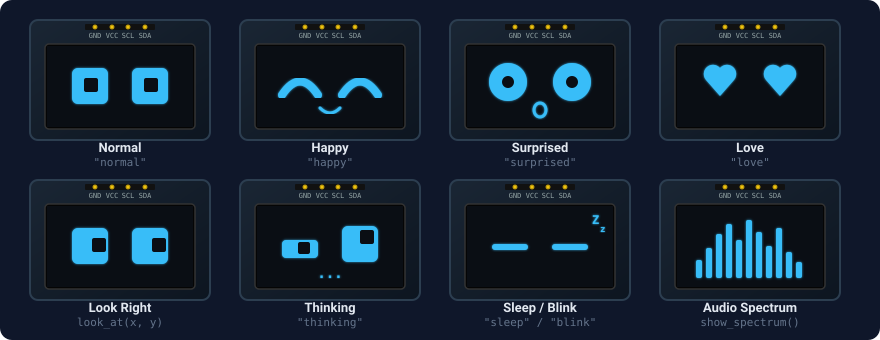

Retseptlar (Recipes)
===================

Ushbu bo'limda ``espzero`` yordamida turli xil sensorlar va komponentlarni boshqarish bo'yicha amaliy misollar keltirilgan. Barcha misollarda ``import espzero; espzero.begin()`` chaqirilgan deb hisoblanadi.

O'rnatilgan LED (Built-in LED)
------------------------------

Platadagi LEDni boshqarishning eng oson yo'li.

.. code-block:: python

    from espzero import esp_led
    from time import sleep

    esp_led.on()    # Yoqish
    sleep(1)
    esp_led.off()   # O'chirish
    esp_led.blink() # Orqa fonda miltillash

Raqamli chiqish (LED)
---------------------

Muayyan pinga ulangan oddiy LEDni boshqarish.

.. image:: /images/circuit_led.svg
    :alt: ESP32 LED sxemasi
    :align: center

.. code-block:: python

    from espzero import LED

    led = LED(4) # GPIO 4

    led.on()
    led.off()
    led.toggle()
    
    # 0.5 soniya oralig'ida 5 marta miltillash (asinxron)
    led.blink(on_time=0.5, off_time=0.5, n=5)

PWM boshqaruvi (Yorqinlikni sozlash)
~~~~~~~~~~~~~~~~~~~~~~~~~~~~~~~~~~~

.. code-block:: python

    led.value = 0.5 # 50% yorqinlik
    led.pulse()     # Sekin yonib-o'chish

RGB LED
-------

Tashqi 4-pinli RGB LED
~~~~~~~~~~~~~~~~~~~~~~

Turli xil ranglarni yaratish uchun Qizil, Yashil va Moviy pinlarni birlashtiring.
(Eslatma: ESP32-S3 platalarida 22–34 pinlar mavjud emas, shuning uchun GPIO 4, 5, 6 kabi pinlardan foydalaning.)

.. image:: /images/circuit_rgb.svg
    :alt: ESP32 RGB LED sxemasi
    :align: center

.. code-block:: python

    from espzero import RGBLED
    from time import sleep

    # ESP32 va ESP32-S3 uchun umumiy qo'llab-quvvatlanadigan pinlar (masalan, GPIO 4, 5, 6)
    rgb = RGBLED(red=4, green=5, blue=6)

    rgb.color = (255, 0, 0)   # Qizil
    sleep(0.5)
    rgb.color = (0, 255, 0)   # Yashil
    sleep(0.5)
    rgb.color = (255, 255, 0) # Sariq (Qizil + Yashil)
    sleep(0.5)

    # Alohida kanal yorqinligini boshqarish (0~255)
    rgb.red = 128
    rgb.blue = 255

    # Rangni teskari aylantirish (invert) va holatni almashtirish (toggle)
    rgb.invert()
    rgb.toggle()

    # Avtomatik animatsiyalar (miltillash, ravon pulsatsiya, kamalak aylanishi)
    rgb.blink(on_times=0.5, colors=((255, 0, 0), (0, 255, 0), (0, 0, 255)), n=2, wait=True)
    rgb.pulse(fade_times=1, n=2, wait=True)  # Ravon o'chib-yonish
    rgb.cycle(fade_times=1, n=2, wait=True)  # Kamalak ranglari tsikli

    rgb.off()

O'rnatilgan RGB LED (ESP32-S3 WS2812 NeoPixel)
~~~~~~~~~~~~~~~~~~~~~~~~~~~~~~~~~~~~~~~~~~~~~~

O'rnatilgan WS2812 NeoPixel RGB LED (ESP32-S3 DevKit yoki M5Stack) bo'lgan platalar uchun pin raqamlarini ko'rsatmasdan ``esp_led`` dan foydalaning:

.. code-block:: python

    from espzero import esp_led
    from time import sleep

    esp_led.color = (255, 0, 0)   # Qizil
    sleep(0.5)
    esp_led.color = (0, 255, 0)   # Yashil
    sleep(0.5)
    esp_led.color = (0, 0, 255)   # Moviy
    sleep(0.5)

    # O'rnatilgan NeoPixel kamalak aylanish effekti
    esp_led.cycle(fade_times=0.5, n=3, wait=True)
    esp_led.off()

Buzzer va Dinamik (Buzzer & Speaker)
------------------------------------

Oddiy signal (Beep)
~~~~~~~~~~~~~~~~~~~

.. image:: /images/circuit_buzzer.svg
    :alt: ESP32-S3 Buzzer sxemasi
    :align: center

.. code-block:: python

    from espzero import Buzzer

    bz = Buzzer(15)
    bz.beep(on_time=0.1, off_time=0.1, n=3) # "Bip-Bip-Bip"

Melodiyalarni ijro etish (Play)
~~~~~~~~~~~~~~~~~~~~~~~~~~~~~~~

.. code-block:: python

    from espzero import Speaker

    spk = Speaker(15)

    # (nota, davomiylik) tuplar ro'yxati
    tune = [
        ('c4', 0.5), ('d4', 0.5), ('e4', 0.5), ('c4', 0.5),
        ('e4', 0.5), ('c4', 0.5), ('g4', 1.0)
    ]
    spk.play(tune)

Kirish qurilmalari (Input Devices)
----------------------------------

Tugma (Button)
~~~~~~~~~~~~~~

.. image:: /images/circuit_button.svg
    :alt: ESP32 Tugma sxemasi
    :align: center

.. code-block:: python

    from espzero import Button

    btn = Button(5)

    btn.when_pressed = lambda: print("Bosildi!")
    btn.when_released = lambda: print("Qo'yib yuborildi!")

Potentiometr
~~~~~~~~~~~~

.. image:: /images/circuit_potentiometer.svg
    :alt: ESP32 Potentiometr sxemasi
    :align: center

.. code-block:: python

    from espzero import Pot

    pot = Pot(1) # Analog pin (ADC1_CH0, ESP32-S3)

    print("Joriy qiymat (0-1):", pot.value)
    print("Kuchlanish (V):", pot.voltage)

Servo motor (Servo)
~~~~~~~~~~~~~~~~~~~

Standart servo motorlarni nisbat (0.0 dan 1.0 gacha) yoki burchak (0 dan 180 gradusgacha) bo'yicha boshqarish (``picozero-rw`` bilan to'liq mos):

.. image:: /images/circuit_servo.svg
    :alt: ESP32 Servo motor sxemasi
    :align: center

.. code-block:: python

    from espzero import Servo
    from time import sleep

    servo = Servo(13)

    # Holatni boshqarish (0.0: min, 0.5: o'rta, 1.0: maks)
    servo.mid()
    sleep(1)

    # Aniq burchakka burish (move_to_degree API)
    servo.move_to_degree(90)   # 90 gradus (markaz)
    sleep(1)
    servo.move_to_degree(180)  # 180 gradus (maks)
    sleep(1)
    servo.move_to_degree(0)    # 0 gradus (min)

    # Ravon tebranish (0 <-> 180 gradus uzluksiz harakat)
    servo.pulse(fade_in_time=1, fade_out_time=1)

Motorlar va Robotlar (Motor & Robot)
------------------------------------

DC Motor (Motor)
~~~~~~~~~~~~~~~~

Drayver platalari (masalan, L298N, L9110S, DRV8833) orqali ikki yo'nalishli DC motorni boshqarish:

.. image:: /images/circuit_motor.svg
    :alt: ESP32 DC Motor sxemasi
    :align: center

.. code-block:: python

    from espzero import Motor
    from time import sleep

    # Oldinga va orqaga pinlarini ko'rsatish (PWM tezlikni boshqarish)
    motor = Motor(forward=4, backward=5)

    # To'liq tezlikda oldinga aylantirish
    motor.forward()
    sleep(1)

    # 50% tezlikda orqaga aylantirish
    motor.backward(0.5)
    sleep(1)

    # Vaqt bilan aylantirish (1 soniya aylanib, avtomatik to'xtaydi)
    motor.forward(speed=0.8, t=1, wait=True)

    # Motorni to'xtatish
    motor.stop()

Robot Rover (Ikki g'ildirakli robot platformasi)
~~~~~~~~~~~~~~~~~~~~~~~~~~~~~~~~~~~~~~~~~~~~~~~~

2 g'ildirakli robot platformasini oldinga, orqaga, chapga va o'ngga boshqarish:

.. image:: /images/circuit_robot.svg
    :alt: ESP32 2 g'ildirakli robot sxemasi
    :align: center

.. code-block:: python

    from espzero import Robot
    from time import sleep

    # left=(oldinga_pin, orqaga_pin), right=(oldinga_pin, orqaga_pin) — kamera bilan to'qnashmaydigan xavfsiz pinlar
    robot = Robot(left=(41, 42), right=(47, 21))

    # Asosiy harakatlar
    robot.forward()
    sleep(1)
    robot.backward(0.6)
    sleep(1)

    # Chapga va o'ngga burilish
    robot.left(speed=0.8)
    sleep(0.5)
    robot.right(speed=0.8)
    sleep(0.5)

    # Vaqt bo'yicha kvadrat shaklida harakatlanish
    for _ in range(4):
        robot.forward(t=1, wait=True)
        robot.left(t=0.5, wait=True)

    # Robotni to'xtatish
    robot.stop()

O'rnatilgan sensorli tugma (Capacitive Touch)
~~~~~~~~~~~~~~~~~~~~~~~~~~~~~~~~~~~~~~~~~~~~

ESP32 va ESP32-S3 chiplariga o'rnatilgan sig'imli sensorli periferiyadan foydalanadi. Tashqi rezistorlarsiz barmog'ingiz bilan teginishni aniqlaydi.

.. code-block:: python

    from espzero import CapTouch
    from time import sleep

    # WROOM: T0~T9 (masalan, GPIO 4), S3: touch pin (masalan, GPIO 1)
    touch = CapTouch(1)

    while True:
        # value: xom o'lchov qiymati (tegilganda kamayadi)
        # is_touched: threshold (standart 300) dan kichik bo'lsa True
        print("Xom qiymat:", touch.value, "Tegildi:", touch.is_touched)
        sleep(0.2)

Masofa sensori (Distance Sensor)
--------------------------------

``HC-SR04P`` (3.3V–5V) kabi ultratovushli sensor yordamida ESP32-S3 bilan masofani xavfsiz o'lchang.

.. image:: /images/circuit_distance.svg
    :alt: ESP32-S3 HC-SR04P Masofa sensori sxemasi
    :align: center

.. warning::
    **Eski 5V faqat HC-SR04 sensorlarida kuchlanish oshishi xavfi (ECHO pin)**:
    ESP32-S3 GPIO pinlarining maksimal kirish kuchlanishi **3.6V** dir. Yangi **HC-SR04P** / **HC-SR04+** modellari platadagi **3V3** piniga ulanib, xavfsiz 3.3V mantiqiy signal bilan ishlaydi.
    Agar faqat 5V da ishlaydigan **eski HC-SR04** sensoridan foydalansangiz, uning ``ECHO`` chiqishi **5V** bo'ladi va ``G14`` pinini shikastlashi mumkin. Shu sababli ``ECHO`` signalini ~3.3V ga tushirish uchun **1kΩ + 2kΩ rezistorli kuchlanish bo'luvchi (Voltage Divider)** (``ECHO → 1kΩ → G14``, ``G14 → 2kΩ → GND``) ulashingiz shart.

.. code-block:: python

    from espzero import DistanceSensor

    # echo=14, trigger=13
    ds = DistanceSensor(echo=14, trigger=13)

    while True:
        print("Masofa: ", ds.distance, "cm")
        sleep(0.5)

Harorat sensori (Temperature Sensor)
------------------------------------

Ichki harorat
~~~~~~~~~~~~~

ESP32 chipining ichki haroratini o'lchang. (Eslatma: Atrof-muhit haroratidan farq qilishi mumkin).

.. code-block:: python

    from espzero import esp_temp_sensor

    print("Chip ichki harorati:", esp_temp_sensor.temp, "C")

Murakkab misol: Tugma bilan chiroqni boshqarish
----------------------------------------------

Tugma bosilganda LED holatini o'zgartirish.

.. code-block:: python

    from espzero import LED, Button, begin

    begin()
    led = LED(4)
    btn = Button(5)

    btn.when_pressed = led.toggle

    while True:
        pass # Hodisalarni kutish

Stepper motor (Stepper motor)
-----------------------------

Drayver platasi (masalan, ULN2003) orqali ulangan stepper motorni boshqarish.

Analog soat (Analog clock)
~~~~~~~~~~~~~~~~~~~~~~~~~~

Uzluksiz ishlaydigan analog soat soniya mili yarating:

.. literalinclude:: examples/stepper_analog_clock.py

Avtomatik jalyuzilar (Automatic blinds)
~~~~~~~~~~~~~~~~~~~~~~~~~~~~~~~~~~~~~~~

Vaqtga asoslangan jalyuzi boshqaruvchisi:

.. literalinclude:: examples/stepper_automatic_blinds.py

Displeylar (OLED & LCD)
-----------------------

I2C OLED Displey (SSD1306 / SH1106, 3.3V Tavsiya etiladi)
~~~~~~~~~~~~~~~~~~~~~~~~~~~~~~~~~~~~~~~~~~~~~~~~~~~~~~~~~

0.96 dyuymli (``SSD1306``) yoki 1.3 dyuymli (``SH1106``) I2C OLED displeylar tabiiy ravishda 3.3V kuchlanish va I2C signalida ishlaydi, shu bois daraja o'zgartirgichsiz to'g'ridan-to'g'ri ESP32-S3 ga xavfsiz ulanadi.

.. image:: /images/circuit_oled.svg
    :alt: ESP32-S3 I2C OLED Displey sxemasi
    :align: center

.. code-block:: python

    from espzero import OLED

    # 0.96" SSD1306 (1.3" SH1106 ekranlar uchun driver="sh1106" kiriting)
    oled = OLED(scl=47, sda=21)

    oled.clear()
    oled.text("Hello, ESPZero!", 0, 0)
    oled.text("ESP32-S3 OLED", 0, 20)
    oled.rect(0, 36, 128, 20, color=1)
    oled.show()

Robot yuzi his-tuyg'ulari va nigohni boshqarish (Robot Face & Gaze)
^^^^^^^^^^^^^^^^^^^^^^^^^^^^^^^^^^^^^^^^^^^^^^^^^^^^^^^^^^^^^^^^^^

``oled.show_face()`` 10 xil robot his-tuyg'usi oldindan sozlangan holatlarini taqdim etadi (``"normal"``, ``"happy"``, ``"surprised"``, ``"love"``, ``"thinking"``, ``"sleep"``, ``"blink"``, ``"angry"``, ``"sad"``, ``"listening"``) va qorachiqlar yo'nalishini (``look_x``, ``look_y``) sozlash imkonini beradi.
Shuningdek, ``oled.look_at(x, y)`` yordamida kamera qo'l koordinatalarini to'g'ridan-to'g'ri uzatib, robot ko'zlarini real vaqtda harakatga qaratish mumkin.

.. code-block:: python

    from espzero import OLED
    from time import sleep

    oled = OLED(scl=47, sda=21)

    # 1. His-tuyg'ularni o'zgartirish
    oled.show_face("happy")      # Xursand yuz (^ ^)
    sleep(1)
    oled.show_face("surprised")  # Hayratlangan yuz (O O)
    sleep(1)
    oled.show_face("love")       # Yurak shaklidagi ko'zlar
    sleep(1)

    # 2. Nigohni boshqarish: Chapga (-1.0) / O'ngga (1.0) / Yuqoriga / Pastga
    oled.show_face("normal", look_x=-1.0, look_y=0.0)  # Chapga qarash
    sleep(1)
    oled.show_face("normal", look_x=1.0, look_y=0.0)   # O'ngga qarash
    sleep(1)

    # 3. vision.get_hand() koordinatalari bilan nigohni kuzatish (interaktiv robot)
    # oled.look_at(hand_x, hand_y, emotion="happy")

LCD Displey (16x2, PCF8574)
~~~~~~~~~~~~~~~~~~~~~~~~~~~

I2C shinasidan va PCF8574 I2C adapteridan foydalanib LiquidCrystal displeylarida (LCD) belgilarni chop etish.

.. warning::
    **5V PCF8574 I2C adapterlari uchun daraja o'zgartirgich (Level Shifter) zarur**:
    Aksariyat ``16x2 I2C LCD (PCF8574)`` modullari 5V da ishlaydi va ``SDA`` / ``SCL`` liniyalarini **5V** ga tortadi (pull-up).
    ESP32-S3 ning 3.3V pinlarini (``G21``, ``G47``) himoya qilish uchun plata va PCF8574 moduli orasiga **3.3V↔5V ikki yo'nalishli I2C mantiqiy daraja o'zgartirgich (Logic Level Shifter)** ulashingiz shart (yoki yuqoridagi **3.3V OLED displeydan** foydalaning).

.. image:: /images/circuit_i2c_lcd.svg
    :alt: ESP32-S3 I2C LCD va mantiqiy daraja o'zgartirgich sxemasi
    :align: center

.. literalinclude:: examples/i2c_lcd.py

Faqat GPIO pinlari yordamida LiquidCrystal displeylarida (LCD) belgilarni chop etish.

.. literalinclude:: examples/lcd.py

AI Vision (AI vizualizatsiyasi)
-------------------------------

ESP32-S3 kamerasi yordamida kompyuter ko'magidagi AI va mustaqil ishlaydigan qurilmadagi AI misollari.

.. important::
    **Kamerani qo'llab-quvvatlovchi proshivka zarur**:
    Rasmiy standart MicroPython proshivkasida xotira cheklovlari tufayli kamera drayveri (``camera`` moduli) mavjud emas.
    Vizual funksiyalardan foydalanish uchun platangizga (ESP32-S3 WROOM CAM) **Kamera drayveri bilan yig'ilgan MicroPython proshivkasi (Camera-enabled Firmware)** o'rnatilgan bo'lishi kerak.

.. note::
    **Proshivka o'rnatish usullari (Mu muharriri / Tashqi vositalar)**:

    * **A usuli (Mu muharriri ichki fleshri)**: Mu pastki o'ng burchagidagi **Sozlamalar (tishli g'ildirak) → [ESP Firmware flasher]** (yoki **[ESP Online Flasher]**) bo'limiga o'ting, plata turini (ESP32-S3) va kamera proshivkasini (``.bin``) tanlab **[Erase & write firmware]** tugmasini bosing.
    * **B usuli (Terminal / ``esptool``)**: VS Code, Thonny kabi boshqa muharrirlardan foydalanganda ``pip install esptool`` o'rnating va terminalda quyidagini bajaring:

      .. code-block:: bash

          esptool --chip esp32s3 --port COMx erase_flash
          esptool --chip esp32s3 --port COMx --baud 460800 write_flash -z 0x0 firmware.bin

PC ko'magidagi AI (MediaPipe bilan — Faqat Mu Muharriri)
~~~~~~~~~~~~~~~~~~~~~~~~~~~~~~~~~~~~~~~~~~~~~~~~~~~~~~~~

.. note::
    **Faqat Mu Muharriri serial protokoli**: ``vision.start_stream_to_pc()`` USB serial orqali Mu muharririning ichki Kamera/MediaPipe ko'ruvchisi bilan bevosita ishlaydi. VS Code, Thonny kabi boshqa muharrirlarda quyidagi **Wi-Fi orqali video uzatish (``vision.start_wifi_stream()``)** usulidan foydalaning.

Kamera tasvirlarini kompyuterga (Mu Muharriri) uzatadi va u real vaqt rejimida qo'llarni, yuzlarni va h.k.larni kuzatish uchun Google MediaPipe kutubxonasidan foydalanadi. Aniqlangan koordinatalar apparat boshqaruvi uchun ESP32 ga qaytarib yuboriladi.

.. code-block:: python

    from espzero import vision
    from time import sleep

    # Kamera kadrlarini kompyuterga uzatishni boshlash (asinxron fon oqimi)
    vision.start_stream_to_pc()

    while True:
        # Muharrir tomonidan kiritilgan qo'l koordinatalarini o'qish
        if "__pc_ai_data" in globals():
            x = __pc_ai_data.get("hand_x", 0)
            y = __pc_ai_data.get("hand_y", 0)
            detected = __pc_ai_data.get("hand_detected", False)
            if detected:
                print("Qo'l aniqlandi -> X:", x, "Y:", y)
        sleep(0.1)

Wi-Fi orqali video uzatish va kompyuterda YOLO avtonom boshqaruvi
~~~~~~~~~~~~~~~~~~~~~~~~~~~~~~~~~~~~~~~~~~~~~~~~~~~~~~~~~~~~~~~~~

Mikrokontroller sifatida ESP32-S3 cheklangan RAM va hisoblash quvvatiga ega bo'lib, YOLOv8 kabi og'ir zamonaviy chuqur o'rganish (deep learning) modellarini to'g'ridan-to'g'ri qurilmada ishga tushirish qiyin.
Biroq, ESP32 va kompyuter o'rtasida **Wi-Fi** orqali vazifalarni taqsimlash orqali siz yuqori samarali avtonom harakatlanuvchi robot mashinani osongina yaratishingiz mumkin.

**Ishlash printsipi va vazifalar taqsimoti**:

.. code-block:: text

    [ ESP32 Robot Mashina ] (Ko'zlar va Oyoqlar roli)
      - Wi-Fi orqali kamera videosini simsiz uzatadi (MJPEG oqimi)
      - Kompyuterdan qabul qilingan simsiz buyruqlar ('GO' / 'STOP') asosida motorlarni harakatga keltiradi
      ▲
      │  (Wi-Fi tarmog'i: Real vaqtda video uzatish & Haydash buyruqlari)
      ▼
    [ Kompyuter / Mu Muharriri - Python 3 rejimi ] (Miya roli)
      - Wi-Fi video oqimini qabul qiladi va kompyuterning yuqori quvvatli CPU/GPU sida YOLOv8 ni ishlatadi
      - Odam/to'siq aniqlanganda darhol 'STOP', yo'l ochiq bo'lsa 'GO' buyrug'ini yuboradi

**Bosqichma-bosqich Amaliy Qo'llanma (Mu Muharriri / Standart Python IDElar)**:

1. **Kompyuterda YOLO muhitini tayyorlash**:
   Kompyuteringizda YOLOv8 ni ishga tushirish uchun paketlarni tayyorlang:

   * **A usuli (Mu muharriri muhitida)**: Mu muharririda ``opencv-python`` va ``requests`` paketlari allaqachon mavjud. Faqatgina **Sozlamalar (tishli g'ildirak) → [Third-party Packages]** bo'limiga o'tib, ``ultralytics`` deb yozing va [OK] bosing.
   * **B usuli (VS Code va boshqa tashqi muharrirlarda)**: Mu dan tashqari standart Python muhitida ishlatayotgan bo'lsangiz, CMD yoki PowerShell da quyidagi buyruqni bajaring: ``pip install ultralytics opencv-python requests``.

2. **1-bosqich: ESP32 Robot kodini yuklash (Mu [ESP32 rejimi] yoki Thonny / ``mpremote``)**:
   Quyidagi kodni plataga ``main.py`` nomi bilan saqlang (Mu da **ESP32 rejimi**, terminalda ``mpremote cp main.py :main.py``).
   (``main.py`` qilib saqlanganda, USB kabelni uzib, faqat batareya ulaganingizda ham plata o'z-o'zidan Wi-Fi ga ulanadi va simsiz video uzatishni boshlaydi. REPL da chiqqan ESP32 IP manzilini (masalan, ``192.168.0.50``) eslab qoling.)

   .. code-block:: python

       from espzero import WiFi, vision, Robot
       from time import sleep

       # 1. Wi-Fi ga ulanish
       wifi = WiFi()
       wifi.connect("Mening_WiFi_Nomi", "parol1234")

       # 2. 2 g'ildirakli robot motorini kamera bilan to'qnashmaydigan pinlarda sozlash (Chap: 41, 42 / O'ng: 47, 21)
       car = Robot(left=(41, 42), right=(47, 21))

       # 3. Simsiz kamera oqimini boshlash (standart port: 8080)
       vision.start_wifi_stream(port=8080)

       # 4. Kompyuter AI qarorlarini qabul qilish va boshqarish davri
       while True:
           if "__pc_ai_data" in globals():
               action = __pc_ai_data.get("action", "STOP")
               if action == "GO":
                   car.forward(0.6) # Yo'l bo'sh bo'lsa oldinga harakatlanish
               else:
                   car.stop()       # Odam yoki to'siq aniqlanganda to'xtash
           sleep(0.05)

3. **2-bosqich: Kompyuter AI Avtonom Boshqaruvchisini ishga tushirish (Mu [Python 3 rejimi] yoki standart Python)**:
   Mu muharririda **Python 3 rejimi**\ da ishga tushiring, yoki VS Code / terminalda ``yolo_drive.py`` fayliga saqlab ``python yolo_drive.py`` buyrug'i bilan bajaring (avval ``STREAM_URL`` va ``CMD_URL`` ga ESP32 IP manzilini kiriting).
   Kompyuteringizda real vaqtda aniqlangan obyektlar ramka bilan ko'rsatilgan video oyna ochiladi va robot mashina avtonom harakatni boshlaydi.

   .. code-block:: python

       import cv2
       import requests
       from ultralytics import YOLO

       # Yengil YOLOv8 modelini yuklash va ESP32 oqim manzilini belgilash
       model = YOLO("yolov8n.pt")
       STREAM_URL = "http://192.168.0.50:8080/"  # ESP32 IP manzili
       CMD_URL = "http://192.168.0.50:8080/ai"

       cap = cv2.VideoCapture(STREAM_URL)

       while cap.isOpened():
           ret, frame = cap.read()
           if not ret:
               break

           # Real vaqtda obyektni aniqlash (0: Odam, 9: Svetofor)
           results = model(frame, verbose=False)
           person_detected = False

           for r in results:
               for box in r.boxes:
                   cls_id = int(box.cls[0])
                   if cls_id == 0: # Odam aniqlandi
                       person_detected = True

           # Buyruq yuborish (STOP yoki GO)
           cmd = "STOP" if person_detected else "GO"
           try:
               requests.get(f"{CMD_URL}?action={cmd}", timeout=0.1)
           except Exception:
               pass

           # Natijani ekranda ko'rsatish
           annotated = results[0].plot()
           cv2.imshow("ESP32-S3 YOLO AI Auto-Driving", annotated)
           if cv2.waitKey(1) & 0xFF == ord('q'):
               break

       cap.release()
       cv2.destroyAllWindows()

.. tip::
    **Batareyada mustaqil ishlash va ochiq havoda Hotspot (AP rejimi) bo'yicha maslahatlar**

    * **Kompyutersiz batareyada to'liq simsiz ishlash (main.py sifatida saqlash)**:
      Aqlli mashina, robot yoki kuzatuv kamerasi loyihasini yakunlab, kompyutersiz mustaqil ishlatish uchun kodni ESP32 xotirasiga ``main.py`` nomi bilan saqlang. Shundan so'ng, USB kabelni uzib, faqat batareya ulashingiz kifoya: plata yoqilishi bilanoq avtomatik Wi-Fi ga ulanadi va video uzatish serverini ishga tushiradi.
      Kompyuter yoki smartfoningizdan Mu muharriri kamera oynasidagi Wi-Fi maydoniga (``http://192.168.x.x:8080/``) yoki brauzerga plata IP manzilini kiritib, jonli efirni ko'rishingiz va robotni simsiz boshqarishingiz mumkin.

    * **Wi-Fi router bo'lmagan ochiq havoda yoki sinfda Hotspot (AP rejimi) orqali ishlash**:
      Atrofda Wi-Fi router bo'lmasa ham muammo yo'q! ESP32 ning o'zini simsiz Wi-Fi nuqtasi (Access Point) sifatida yoqib, tashqi internetsiz smartfon yoki noutbuk bilan to'g'ridan-to'g'ri 1:1 bog'lanish mumkin:

      .. code-block:: python

          import network
          from espzero import vision

          # 1. ESP32 ni mustaqil Wi-Fi kirish nuqtasi (AP) sifatida yoqish
          ap = network.WLAN(network.AP_IF)
          ap.active(True)
          ap.config(essid="ESP32-CAM-ROBOT", authmode=network.AUTH_OPEN)

          # 2. Hotspot tarmog'ida video uzatishni boshlash (Standart IP: http://192.168.4.1:8080/)
          vision.start_wifi_stream(port=8080)

      Noutbuk yoki telefoningizdan ``ESP32-CAM-ROBOT`` Wi-Fi tarmog'iga ulaning va brauzer yoki kompyuter dasturida ``http://192.168.4.1:8080/`` manziliga kirib, istalgan joyda simsiz video va AI boshqaruvidan foydalaning.

Qurilmadagi AI (On-Device TFLite)
~~~~~~~~~~~~~~~~~~~~~~~~~~~~~~~~~

Mahalliy AI xulosalarini chiqarish uchun bevosita ESP32 fayl tizimidan ``.tflite`` model faylini yuklaydi. U har qanday kompyuterga ulanmasdan ham mustaqil ishlashi mumkin.

.. note::
    ESP32 va mikrokontrollerlar uchun mo'ljallangan ixcham ``.tflite`` model fayllarini Kaggle Models (https://www.kaggle.com/models?framework=liteRT), Hugging Face LiteRT Community (https://huggingface.co/litert-community) yoki rasmiy TensorFlow Lite Micro repozitoriysidan (https://github.com/tensorflow/tflite-micro) to'g'ridan-to'g'ri yuklab olishingiz mumkin.

.. code-block:: python

    import camera
    import tflite
    from time import sleep

    # Kamerani ishga tushirish va TFLite modelini yuklash
    camera.init(framesize=camera.FRAME_QVGA)
    model = tflite.load("model.tflite")

    while True:
        img = camera.capture()
        if img:
            # Xulosa chiqarish va sinf natijasini olish
            result = model.detect(img)
            print("Aniqlangan sinf ID:", result.class_id)
        sleep(0.5)

AI Ovoz (AI Voice)
------------------

ESP32 platasiga alohida I2S mikrofon qo'shmasdan ham, **kompyuter yoki noutbukning yuqori sifatli ichki mikrofonidan** foydalanib Wi-Fi orqali ESP32 avtomobil va robotini ovoz bilan boshqarish mumkin.

Kompyuter mikrofoni orqali ovoz bilan boshqariladigan aqlli avtomobil
~~~~~~~~~~~~~~~~~~~~~~~~~~~~~~~~~~~~~~~~~~~~~~~~~~~~~~~~~~~~~~~~~~~~~

Bu usul simlarni ulashni minimal darajaga tushiradi va shovqinli xonalarda ham aniq ovoz tanishni ta'minlaydi.

**Ishlash prinsipi va vazifalar taqsimoti**:

.. code-block:: text

    [ Foydalanuvchi ]
      🗣️ "Oldinga!" / "To'xta!" / "Aylan!"
      │
      ▼ (Kompyuter / Noutbuk ichki mikrofonida yozib olinadi)
    [ Mu Muharriri (Kompyuter) - Python 3 Rejimi ] (Quloq va Aql)
      - Kompyuter mikrofonidan ovoz oladi va ichki SpeechRecognition yordamida tahlil qiladi
      - Wi-Fi HTTP so'rovi orqali buyruqlarni yuboradi:
        requests.get("http://<ESP32_IP>:8080/ai?action=GO")
      ▲
      │  (Wi-Fi tarmog'i: Matnli buyruqlarni uzatish)
      ▼
    [ ESP32 Robot Avtomobili ] (Tana, Mikrofon/OLED keraksiz!)
      - Qabul qilingan action ("GO") buyrug'ini darhol bajaradi
      - Motorlarni harakatga keltiradi va platadagi LED orqali holatni bildiradi

**Bosqichma-bosqich qo'llanma (Mu Muharriri / Standart Python IDElar)**:

1. **Kompyuterda ovoz tanish muhitini tayyorlash**:
   * **A usuli (Mu muharriri muhitida)**: Mu muharririda ``SpeechRecognition`` va ``requests`` paketlari allaqachon mavjud, shu sababli **hech qanday qo'shimcha o'rnatishlarsiz to'g'ridan-to'g'ri ishga tushirish mumkin**.
   * **B usuli (VS Code va boshqa tashqi muharrirlarda)**: Standart Python muhitida ishlatayotgan bo'lsangiz, CMD yoki PowerShell da quyidagi buyruqni bajaring: ``pip install SpeechRecognition requests PyAudio``.

2. **1-qadam: ESP32 Robot Avtomobili kodini yuklash (Mu [ESP32 Rejimi] yoki Thonny / ``mpremote``)**:

   .. literalinclude:: ../examples/voice_control_car.py

3. **2-qadam: Kompyuter Ovozli Boshqaruv skriptini ishga tushirish (Mu [Python 3 Rejimi] yoki standart Python)**:
   Mu muharririda **Python 3 Rejimida** (yoki VS Code / terminalda ``python voice_controller.py`` orqali) ``ESP_IP`` o'rniga platangiz IP manzilini kiritib ishga tushiring:

   .. code-block:: python

       import requests
       import speech_recognition as sr

       ESP_IP = "192.168.0.50"  # ESP32 IP manzili
       CMD_URL = f"http://{ESP_IP}:8080/ai"

       recognizer = sr.Recognizer()
       mic = sr.Microphone()  # Kompyuter mikrofoni

       print("=== Ovoz bilan boshqariladigan avtomobil boshqaruvchisi ===")
       print("Buyruqlar: 'oldinga', 'orqaga', 'chapga', "o'ngga", "to'xta", 'raqs'")

       with mic as source:
           recognizer.adjust_for_ambient_noise(source)

       while True:
           print("\n[Eshitmoqdaman... Gapiring]")
           with mic as source:
               audio = recognizer.listen(source)

           try:
               # O'zbek tili (uz-UZ) da Google Speech Recognition orqali ovozni aniqlash
               text = recognizer.recognize_google(audio, language="uz-UZ").lower()
               print("Eshitildi:", text)

               action = None

               if "oldinga" in text or "yur" in text or "ketdik" in text:
                   action = "GO"
               elif "orqaga" in text:
                   action = "BACK"
               elif "chap" in text:
                   action = "LEFT"
               elif "o'ng" in text or "ong" in text:
                   action = "RIGHT"
               elif "to'xta" in text or "toxta" in text or "stop" in text:
                   action = "STOP"
               elif "raqs" in text or "o'yna" in text:
                   action = "DANCE"

               if action:
                   requests.get(CMD_URL, params={"action": action}, timeout=0.5)

           except sr.UnknownValueError:
               pass
           except Exception as e:
               print("Xatolik:", e)

